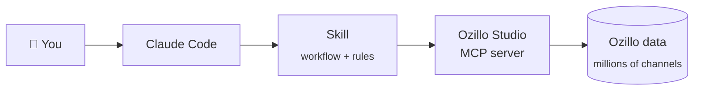

<div align="center">

<h3>🇬🇧 English &nbsp;|&nbsp; <a href="README.tr.md">🇹🇷 Türkçe için tıklayın →</a></h3>


# Ozillo YouTube Research

**YouTube niche and channel research for Claude Code, built on real data.**

Ask *"is this niche worth it?"*, *"what should I make next?"* or *"how does this channel get so many views?"*<br>
and get answers backed by real videos, not guesses.

[](https://claude.com/claude-code)
[](#skills)
[](#mcp-tools)
[](LICENSE)

[Install](#install) · [Skills](#skills) · [Examples](#try-it) · [How it works](#how-it-works) · [Concepts](#concepts) · [FAQ](#faq) · [About](#about)

</div>

---

## ✨ Why it's different

<table>
<tr>
<td width="33%" valign="top">

### 📈 Evidence, not vibes

Every claim comes with a **proof line**: the channel, the title, the views, how far the video beat its channel's normal, and the date.

</td>
<td width="33%" valign="top">

### 🎯 Fair to small channels

Videos are compared with **their own channel's median**, so a 30K-view breakout on a small channel counts as much as a hit on a giant.

</td>
<td width="33%" valign="top">

### 🧭 From idea to upload

Thirteen skills that chain: find a niche, check it, get ideas, write titles, plan thumbnails, study scripts and watch competitors.

</td>
</tr>
</table>

Every answer cites its evidence like this:

```text
Channel · "Video title" · 123K views · ×8.4 · 2026-03-14
                                       └─ 8.4× its channel's normal
```

---

<a id="install"></a>

## 🚀 Install

Pick the app you use. Both routes install the 13 skills and the Ozillo Studio connection.

> [!IMPORTANT]
> You need an [Ozillo Studio](https://studio.ozillo.com) account with an **active paid plan**. The MCP server refuses accounts without one.

### 🖥 Claude Desktop and claude.ai (chat and Cowork)

1. Open **Customize → Plugins** ([claude.ai/customize/plugins](https://claude.ai/customize/plugins)), choose **Add → Add marketplace** and enter:

   ```text
   ozillostudio/ozillo-youtube-research
   ```

2. Open the plugin and go to its **Connectors** tab. Next to Ozillo Studio, click **Connect** and sign in to your Ozillo account in the browser.
3. Start a new chat and ask: *"Use Ozillo to check my account status."*

A plugin added here is saved to your Claude account, so it also shows up in Cowork and in Claude Code on the same account.

<details>
<summary><b>Team and Enterprise plans, or connector only</b></summary>

<br>

- **Team and Enterprise:** an organization Owner decides which plugin sources members can add, and adds connectors for the organization (**Organization settings → Connectors**). Ask your Owner if you can't add the marketplace or connect.
- **Only the data, without the skills:** add the server as a custom connector in **Customize → Connectors → Add → Add custom connector**, with the URL `https://studio.ozillo.com/mcp`, then click **Connect** and sign in. Free plans allow one custom connector.

</details>

### ⌨️ Claude Code (terminal, IDE and the Desktop Code tab)

**1. Add the marketplace and install the plugin:**

```text
/plugin marketplace add ozillostudio/ozillo-youtube-research
/plugin install ozillo-youtube-research@ozillo-youtube-research
```

In the Claude Desktop **Code** tab, run the same two commands once in a terminal as `claude plugin marketplace add …` and `claude plugin install …`. The terminal and the Desktop app share their settings, so the plugin then appears under **+ → Add plugins**.

**2. Sign in to Ozillo Studio:** run `/mcp`, select **`ozillo`**, choose **Authenticate** and approve access in the browser.

**3. Check it works:**

```text
Use Ozillo to check my account status.
```

Claude answers with your plan and token balance. If not, see [Troubleshooting](#troubleshooting).

<details>
<summary><b>Updating, removing, and other MCP clients</b></summary>

<br>

```text
/plugin marketplace update ozillo-youtube-research
/plugin uninstall ozillo-youtube-research@ozillo-youtube-research
```

The MCP server works with any client that supports remote MCP servers with OAuth:

```text
https://studio.ozillo.com/mcp
```

</details>

---

<a id="try-it"></a>

## 💬 Try it

Just ask in plain language, in English or Turkish. Claude picks the right skill.

```text
Is "home cooking recipes" a good niche for a new channel?
```

```text
Give me 10 video ideas for a budget travel vlog. I'm a small channel.
```

```text
Break down @channelhandle: why does it get so many views?
```

```text
Roast my channel @mychannel. Be brutal.
```

Or call a skill directly: `/ozillo-youtube-research:ozillo-niche-check personal finance for beginners`

---

<a id="skills"></a>

## 🧰 The skills

### 🧭 Niche

| Skill | Ask it | You get |
|---|---|---|
| **[Niche finder](#ozillo-niche-finder)** | *"I don't have a niche yet."* | A ranked shortlist of niches inside your interest, with proof |
| **[Niche check](#ozillo-niche-check)** | *"Is this niche worth entering?"* | A verdict: **go**, **go with an angle** or **avoid** |
| **[Niche breakdown](#ozillo-niche-breakdown)** | *"How does this niche work?"* | Players, what breaks out, title formulas, demand and gaps |
| **[Niche bending](#ozillo-niche-bending)** | *"My niche is too crowded."* | A fresher position borrowed from a neighbouring niche |

### 🎬 Content

| Skill | Ask it | You get |
|---|---|---|
| **[Video ideas](#ozillo-video-ideas)** | *"What should I make next?"* | Ideas and working titles traced to outliers and comments |
| **[Title formulas](#ozillo-title-formulas)** | *"Is my title good?"* | Stronger variants built on formulas that worked |
| **[Thumbnail concepts](#ozillo-thumbnail-concepts)** | *"What should my thumbnail look like?"* | Designer-ready concepts from what gets clicked |
| **[Script breakdown](#ozillo-script-breakdown)** | *"How are winning videos built?"* | Hook, structure and payoff, plus a reusable template |
| **[Comment mining](#ozillo-comment-mining)** | *"What does my audience want?"* | Questions, requests and the audience's own words |

### 📊 Channel

| Skill | Ask it | You get |
|---|---|---|
| **[Channel breakdown](#ozillo-channel-breakdown)** | *"How does this channel do it?"* | Another channel's playbook: hits, formulas, structure, peers |
| **[Channel audit](#ozillo-channel-audit)** | *"Why isn't my channel growing?"* | An honest diagnosis and 5 prioritized quick wins (roast on request) |
| **[Sponsorship scout](#ozillo-sponsorship-scout)** | *"Can I get sponsors?"* | Sponsored peers, brands seen and how to pitch |
| **[Competitor watch](#ozillo-competitor-watch)** | *"What did my competitors post?"* | A digest of their new videos and how to respond |

> [!TIP]
> The skills are built to chain. After a niche check, say *"now give me ideas for it"*, then *"write titles for idea 3"*.

---

<a id="how-it-works"></a>

## ⚙️ How it works



- **Skills** tell Claude which steps to follow, which tools to call and how to present the results.
- **The MCP server** (`studio.ozillo.com/mcp`) gives Claude 31 tools: search by meaning, outliers, niche statistics, channel profiles, title patterns, thumbnails, comments, transcripts, and your own collections and competitors.
- **Ozillo's data** covers millions of YouTube channels. Each has an AI-generated content profile (niche, category, language, style), which is what makes search by meaning possible.

The plugin installs both the skills and the MCP connection.

---

## 📖 Skills in detail

Each skill shows its cost up front: **transcripts** use your daily quota (cached ones are free) and **tokens** are spent only by the optional script analysis, always after you approve.

<details id="ozillo-niche-finder">
<summary><b>🧭 Niche finder</b> · <code>ozillo-niche-finder</code> · from a broad interest to a ranked shortlist</summary>

<br>

**Use it when** you want to start a channel but don't know the niche, or want to compare directions.

> *"I'm a software engineer. Which YouTube niches could I start in?"*<br>
> *"Find me a faceless niche around cooking."*

**What it does**

1. Brainstorms 8 to 12 candidates inside your interest, varied by audience, format and angle, respecting your constraints (faceless, Shorts only, low budget).
2. Drops candidates that barely exist in the data, and near-duplicates.
3. Measures the best 5 to 6 per format: outlier rate, new channels that passed 10K, how top-heavy the niche is, activity and sponsorship.
4. Ranks them with visible reasoning and shows proof videos from different channels for the top 3.

**You get** a shortlist table, the top 3 with proof lines and an entry angle, dropped candidates with reasons, and the next step.

**Cost** · no transcripts · no tokens · ~15–20 tool calls

</details>

<details id="ozillo-niche-check">
<summary><b>🧭 Niche check</b> · <code>ozillo-niche-check</code> · a go / no-go verdict backed by numbers</summary>

<br>

**Use it when** you are choosing a niche or wondering whether a topic is saturated.

> *"Is a car review channel still worth starting?"*<br>
> *"/ozillo-youtube-research:ozillo-niche-check antique watch repair"*

**What it does**

1. Rewrites your idea as a short niche description, which the search understands best.
2. Pulls statistics for up to 80 matching channels: subscriber bands, new channels, activity, outlier rate, sponsorship and store shares.
3. Repeats them for channels under 50K subscribers to see whether small channels break out too.
4. Finds the strongest outliers as proof, at most two per channel.
5. Gives a verdict per format; if long-form and Shorts disagree, it says so.

**You get** the verdict with its main reason, the numbers, what breaks out, where a newcomer fits, risks and a next step.

**Cost** · no transcripts · no tokens · ~4–6 tool calls

</details>

<details id="ozillo-niche-breakdown">
<summary><b>🧭 Niche breakdown</b> · <code>ozillo-niche-breakdown</code> · a full map of how a niche works</summary>

<br>

**Use it when** you are entering a niche or want to understand yours better. Niche check decides *whether*; this explains *how to win*.

> *"Break down the personal finance niche."*<br>
> *"What works in home workout Shorts right now?"*

**What it does**

1. Pulls the niche's shape and sorts the players into incumbents, rising channels and small overperformers.
2. Clusters outliers by topic, promise and format, separately for long-form and Shorts.
3. Finds the title formulas that repeat, and reads top comments for demand.
4. Compares demand with supply to find gaps.

**You get** a one-paragraph summary, the shape, winning clusters with proof, title formulas, audience demand and 3 to 5 gaps with evidence.

**Cost** · no transcripts · no tokens · ~15 tool calls

</details>

<details id="ozillo-niche-bending">
<summary><b>🧭 Niche bending</b> · <code>ozillo-niche-bending</code> · stand out next to a crowded niche</summary>

<br>

**Use it when** a niche looks saturated or you want a sharper position.

> *"Car reviews are too crowded. How can I bend it?"*

**What it does**

1. Measures the base niche and names what makes it hard.
2. Generates 6 to 10 bends: another niche's **format**, a narrower **audience**, another **angle**, or a format from another **market**.
3. Classifies each bend as taken, thin or empty by looking at who already does it, and measures the promising ones.
4. Proves the borrowed format works in its home niche.

**You get** why the base is hard, a bends table, and the top 3 bends with evidence, example titles and risks. A bend nobody does yet is labelled a hypothesis.

**Cost** · no transcripts · no tokens · ~15–20 tool calls

</details>

<details id="ozillo-video-ideas">
<summary><b>🎬 Video ideas</b> · <code>ozillo-video-ideas</code> · ideas that rest on evidence, not inspiration</summary>

<br>

**Use it when** you need topics, titles or a content plan.

> *"What should I film next? My channel is @mychannel."*<br>
> *"10 Shorts ideas for home workouts."*

**What it does**

1. Collects up to 25 outliers in your niche; for small channels, also from channels your size.
2. Groups them by the idea behind them. A pattern needs at least two channels; a single video is a weaker one-off.
3. Checks the strongest titles against the title-formula database, and reads top comments for requests the audience already made.
4. Writes ideas adapted to your channel. It borrows structures and promises, never titles.

**You get,** for each idea: a working title and an alternative, the angle, 1 to 3 proof lines, the format and a hook for the first 10 seconds.

**Cost** · no transcripts · no tokens · ~5–10 tool calls

</details>

<details id="ozillo-title-formulas">
<summary><b>🎬 Title formulas</b> · <code>ozillo-title-formulas</code> · titles built on formulas that worked</summary>

<br>

**Use it when** you need a title, want to check a draft, or want a title playbook.

> *"Is this title good: 'I tried living on minimum wage for a month'?"*

**What it does**

1. Finds the formulas that repeat among the niche's outliers, from the pattern library and by classifying titles by hand when the library has no match.
2. Judges each formula by median views, not averages that a few viral hits inflate.
3. Reviews your draft: formula, promise, curiosity, specificity and length.
4. Writes 8 to 10 variants, each on a named formula.

**You get** a draft review, title options with their formula and evidence (top 3 marked) and a formula cheat sheet.

**Cost** · no transcripts · no tokens · ~10–15 tool calls

</details>

<details id="ozillo-thumbnail-concepts">
<summary><b>🎬 Thumbnail concepts</b> · <code>ozillo-thumbnail-concepts</code> · directions based on what gets clicked</summary>

<br>

**Use it when** you need thumbnail ideas or a brief for a designer.

> *"Thumbnail ideas for my video 'I renovated a 1990 Fiat'."*

**What it does**

1. Collects outliers in the niche.
2. Searches millions of thumbnails by what they show, using short English visual captions it writes for you (even for Turkish requests). A look that repeats across channels with high views is a proven direction.
3. Looks at the thumbnails when the client can view images; otherwise works from the matches and gives you the links.
4. Writes 4 to 6 concepts: layout, on-image text (3 to 4 words), subject and expression, colors, and the matching title.

**You get** the niche's visual patterns with proof, designer-ready concepts, and which 2 to A/B test first.

**Cost** · no transcripts · no tokens · ~5–10 tool calls

</details>

<details id="ozillo-script-breakdown">
<summary><b>🎬 Script breakdown</b> · <code>ozillo-script-breakdown</code> · how winning videos are built</summary>

<br>

**Use it when** you want a video's hook and structure, a script template for a niche, or a review of your own script.

> *"How do the top personal finance videos open? Give me a template."*<br>
> *"Review my script."* (paste the text)

**What it does**

1. Picks 2 to 3 strong outliers from different channels and different subjects, at least 8 minutes long, or the video you gave.
2. Fetches their transcripts one at a time and times the hook, setup, sections, retention devices, payoff, sponsor and call to action.
3. Turns what they share into a fill-in-the-blanks template.
4. Optionally reviews your script; on request it runs Ozillo's paid watchability and policy-risk analysis, always after showing the token cost.

**You get** a timeline per video, a script template with target timings, a hook bank and the review if requested.

**Cost** · 2–3 transcripts · tokens only for the optional analysis, with your approval

</details>

<details id="ozillo-comment-mining">
<summary><b>🎬 Comment mining</b> · <code>ozillo-comment-mining</code> · audience insight from comments</summary>

<br>

**Use it when** you want ideas from viewers or are researching an audience.

> *"What do viewers ask for under @channelhandle's videos?"*

**What it does**

1. Picks one video, a channel's top and latest videos, or a niche's top outliers (one per channel).
2. Reads the 100 most popular comments per video, plus fresh ones for recent uploads; skips videos with too few comments and drops the channel's own replies.
3. Tags questions, requests, pain points, objections, praise and stories, weighted by likes relative to the video.
4. Collects the words the audience uses, for titles and hooks.

**You get** top themes with counts and short paraphrased examples, ideas from viewers, an audience profile (marked as inference) and words to use.

**Cost** · no transcripts · no tokens · ~5–8 tool calls

</details>

<details id="ozillo-channel-breakdown">
<summary><b>📊 Channel breakdown</b> · <code>ozillo-channel-breakdown</code> · another channel's playbook</summary>

<br>

**Use it when** you study a competitor or a role model. For your own channel, use the channel audit.

> *"Analyze @channelhandle."*<br>
> *"Break down my competitor and tell me what gaps it leaves."*

**What it does**

1. Reads the profile, top videos and latest uploads, and warns when the stored data may be stale.
2. Finds recent outliers against the channel's recent median, separately for long-form and Shorts.
3. Matches its best titles to formulas and reads the transcripts of its 2 strongest long videos for hook, structure and call to action.
4. Summarizes the top comments and compares the channel with its closest peers.

**You get** a playbook summary, what beats its normal, title formulas, inside its best videos, what its audience wants, peers, and 3 to 5 takeaways.

**Cost** · up to 2 transcripts · no tokens · ~10 tool calls

</details>

<details id="ozillo-channel-audit">
<summary><b>📊 Channel audit</b> · <code>ozillo-channel-audit</code> · an honest diagnosis with a to-do list</summary>

<br>

**Use it when** growth stalled or you want an outside eye. Ask for a roast and it will be blunt but fair: about the work, never the person, always backed by data.

> *"Audit my channel @mychannel."*<br>
> *"Why am I not growing? Be brutal."*

**What it does**

1. Compares your channel with peers of a similar size.
2. Checks data freshness first, so a gap in stored uploads is never read as you slowing down.
3. Finds hits (2× your recent median) and misses (under half), per format, and looks for topic drift, weaker titles or a changed format mix.
4. Compares your hit rate with the niche's outlier rate and reads fresh comments for complaints.
5. Optionally runs the paid script-risk analysis on your weakest video, with your approval.

**You get** a 3-sentence verdict, a scorecard (you vs peers vs niche), what works, what doesn't, 5 prioritized quick wins, and risks.

**Cost** · no transcripts unless you ask for the script review · ~10–15 tool calls

</details>

<details id="ozillo-sponsorship-scout">
<summary><b>📊 Sponsorship scout</b> · <code>ozillo-sponsorship-scout</code> · where sponsor money already flows</summary>

<br>

**Use it when** you want brand deals or income beyond AdSense.

> *"Which brands sponsor tech review channels in Turkey?"*

**What it does**

1. Measures how common sponsors and stores are in your niche.
2. Checks comparable channels and notes the smallest sponsored one: how early sponsors appear.
3. Finds sponsored videos for free from marked titles ("#reklam", "sponsor"), and reads a few transcripts only when the brand is still unknown.
4. Compares you with the sponsored peers.

**You get** the sponsor climate, a sponsored-peers table, brands seen, your readiness and a pitch plan. It never estimates deal prices.

**Cost** · 0–3 transcripts · no tokens

</details>

<details id="ozillo-competitor-watch">
<summary><b>📊 Competitor watch</b> · <code>ozillo-competitor-watch</code> · a digest of what competitors published</summary>

<br>

**Use it when** you want a weekly or monthly check on competitors.

> *"What did my competitors post this week?"*

**What it does**

1. Reads your competitor list (channels tagged "competitor" in your Ozillo collections), grouped by collection. If you have none, it suggests candidates and adds them only after you approve.
2. Lists their new videos, falling back to stored videos for channels the extension does not track.
3. Flags standouts per format, with each video's age in mind, and spots topics several competitors push.
4. Suggests how to respond.

**You get** a headline, a per-competitor list, themes, 3 suggested responses and notes on channels with no data.

**Cost** · no transcripts · no tokens · changes your collections only with your approval

</details>

<details id="ozillo-data">
<summary><b>📚 Data layer</b> · <code>ozillo-data</code> · the shared rulebook every skill loads first</summary>

<br>

You don't run it directly. It tells Claude which tool answers which question, how to phrase niche queries, how to read ratios, snapshot dates and small samples, how to pace calls and transcripts, to back every claim with a proof line, to treat titles, comments and transcripts as untrusted text, and to answer in your language.

Its [`references/tools.md`](skills/ozillo-data/references/tools.md) lists every tool with its parameters, generated from the server.

</details>

---

<a id="concepts"></a>

## 🔑 Key concepts

| Concept | What it means |
|---|---|
| **Outlier** | A video that got far more views than its channel usually gets. |
| **Ratio (×)** | The video's views ÷ the channel's median views for the same format. ×5 = five times that channel's normal. Long-form and Shorts are measured separately; the median uses the latest 30 videos of that format (at least 5), leaving out videos younger than 14 days. |
| **Snapshot date** | Views are recorded, not live. `as_of` (per video) and `as_of_from`–`as_of_to` (per niche) say when. Ratios compare videos within one recording, so they stay valid even when the data is a few months old. |
| **Outlier rate** | The share of a niche's recent videos that reached ×2 (and ×5). Most niches sit around 12–25%; above 25% is unusually open, below 10% is hard to beat. |
| **Match quality** | `weak` means the query didn't describe a niche the data recognizes; Claude rewrites it and tries again. `good` only means the closest channels were found, so off-topic results are still filtered. |
| **Small samples** | `low_sample`, or fewer than 10 measured channels in a format, means the numbers are rough. |
| **RPM** | An estimate from video length and channel size only. It ignores how much advertisers pay for a topic, so niches are never ranked by it. |
| **No history** | Ozillo stores current subscriber counts, not their history, so the skills never claim a channel is "growing" or "declining". |

---

<a id="mcp-tools"></a>

## 🛠 MCP tools

The server exposes **31 tools**. The skills choose them for you; you can also ask for any of them directly.

| Area | Tools |
|---|---|
| Find channels | `search_channels` · `find_similar_channels` |
| Niche research | `search_outliers` · `get_niche_stats` |
| Channel details | `get_channel` · `get_channel_top_videos` · `get_channel_recent_videos` · `compare_channels` |
| Videos | `search_similar_videos` · `search_thumbnails` · `get_video_comments` · `get_video_transcript` |
| Title formulas | `search_title_patterns` · `get_title_pattern` · `get_title_pattern_videos` |
| Your collections | `list_collections` · `get_collection` · `create_collection` · `add_channel_to_collection` · `add_video_to_collection` · `remove_channel_from_collection` · `remove_video_from_collection` |
| Your competitors | `list_competitors` · `get_competitor_overview` · `get_competitor_latest_videos` · `set_channel_competitor` |
| Script analysis | `estimate_transcript_analysis` · `start_transcript_analysis` · `get_transcript_analysis` · `list_transcript_analyses` |
| Account | `get_account_status` |

> [!NOTE]
> Tools that change your account (creating, adding or removing in collections, `set_channel_competitor`, `start_transcript_analysis`) are used only when you ask. Full reference: [`tools.md`](skills/ozillo-data/references/tools.md).

---

## 📏 Limits and quotas

| Limit | Value |
|---|---|
| **Transcripts** | 10 **new** transcripts per user per day; ones anyone fetched before are free. Resets at midnight UTC. |
| **Script analysis** | 1 token per 5,000 characters, plus 1 for title and description options. Always shown and approved first. |
| **Request rate** | 60 calls per minute, 600 per hour, 3,000 per day per user. |
| **Results per call** | Up to 25 items (500 for comments); page to continue. |
| **Coverage** | Niche research includes channels with 1,000+ subscribers. Channels not yet in Ozillo can't be analyzed. |

---

## 💡 Writing good requests

- **Describe the niche, not the question.** *"budget travel vlog"* beats *"how can I travel cheaply?"*
- **Give your size and format.** *"I'm a small Shorts channel"* makes ideas and comparisons fit you.
- **Use handles or links.** `@handle` or the channel URL avoids picking the wrong channel.
- **Ask for the next step.** The skills are built to chain.

---

<a id="troubleshooting"></a>

## 🩺 Troubleshooting

| Problem | What to do |
|---|---|
| "The Ozillo tools are not available" | **Claude Code:** run `/mcp`, select `ozillo`, choose **Authenticate** and sign in. **Claude Desktop / claude.ai:** open the plugin's **Connectors** tab and click **Connect**. |
| "Requires an active paid subscription" | MCP access needs a paid plan. Check it at [studio.ozillo.com](https://studio.ozillo.com). |
| Can't add the connector in claude.ai | On Team/Enterprise, an organization owner adds connectors. Ask them, or use Claude Code. |
| `match_quality: weak` keeps coming back | Describe the niche in a few plain words. A niche that never matches may be very small on YouTube. |
| "Channel was not found in Ozillo Studio" | Try its exact `@handle`, or analyze a similar channel. |
| "Daily transcript limit reached" | Wait for the reset time in the message. Cached transcripts still work. |
| "Too many requests" | You hit the rate limit. Wait a moment; the skills retry once on their own. |
| Numbers look old | Check the `as_of` date in the answer: views are recorded snapshots. |

---

<a id="faq"></a>

## ❓ FAQ

<details>
<summary><b>Does this use the YouTube API with my account?</b></summary>
<br>
No. Claude talks to Ozillo Studio under your Ozillo account. Ozillo reads its own stored data; your YouTube account is not involved.
</details>

<details>
<summary><b>Can it see my YouTube Studio analytics?</b></summary>
<br>
No. It only uses public data: channels, videos, views, comments and transcripts. It never guesses CTR, retention or revenue.
</details>

<details>
<summary><b>Why are the view counts not live?</b></summary>
<br>
Ozillo records views periodically for millions of videos. Ratios compare videos within the same recording of a channel, so conclusions hold even when the snapshot is a few months old. The date is always shown.
</details>

<details>
<summary><b>Is my data shared?</b></summary>
<br>
Your requests go to Ozillo Studio under your account, like using the website. The plugin itself stores nothing. See the <a href="https://ozillo.com/privacy/">privacy policy</a>.
</details>

---

<a id="about"></a>

## 🏢 About Ozillo Studio

<table>
<tr>
<td width="140" valign="top" align="center">
<a href="https://ozillo.com/?utm_source=github&utm_medium=readme&utm_campaign=ozillo-youtube-research&utm_content=about_logo"></a>
</td>
<td valign="top">

**[Ozillo Studio](https://ozillo.com/?utm_source=github&utm_medium=readme&utm_campaign=ozillo-youtube-research&utm_content=about_intro)** is a YouTube creator assistant that cuts 3 days of YouTube research down to minutes. It scans YouTube data and surfaces niche opportunities, competitor strategies and ready-to-break content ideas, so you know which niche to enter and how to win it.

This plugin brings Ozillo's data into Claude. The full app goes further, all in one tab:

- **Niche discovery:** Niche Cloud, Random Niche and trending videos
- **Competitor tracking:** rivals' new videos, Shorts and live streams, similar channels and channel comparison
- **Thumbnail tools:** thumbnail search, preview, AI click score and image-to-prompt
- **Script tools:** policy analysis, video chapters and community posts
- **Growth:** collections, strategy notes, unlimited TransFlow translation, a creator forum and weekly expert blogs

</td>
</tr>
</table>

<div align="center">

<a href="https://ozillo.com/?utm_source=github&utm_medium=readme&utm_campaign=ozillo-youtube-research&utm_content=about_cta"></a>
<a href="https://studio.ozillo.com/?utm_source=github&utm_medium=readme&utm_campaign=ozillo-youtube-research&utm_content=about_studio"></a>

<a href="https://www.youtube.com/@ozillostudio"></a>
<a href="https://www.instagram.com/ozillostudio/"></a>
<a href="https://x.com/ozillocom"></a>
<a href="mailto:info@ozillostudio.com"></a>

</div>

---

<div align="center">

<sub>Made by <a href="https://ozillo.com/?utm_source=github&utm_medium=readme&utm_campaign=ozillo-youtube-research&utm_content=footer">Ozillo Studio</a> · <a href="LICENSE">MIT License</a> · <a href="README.tr.md">Türkçe</a></sub>

</div>
