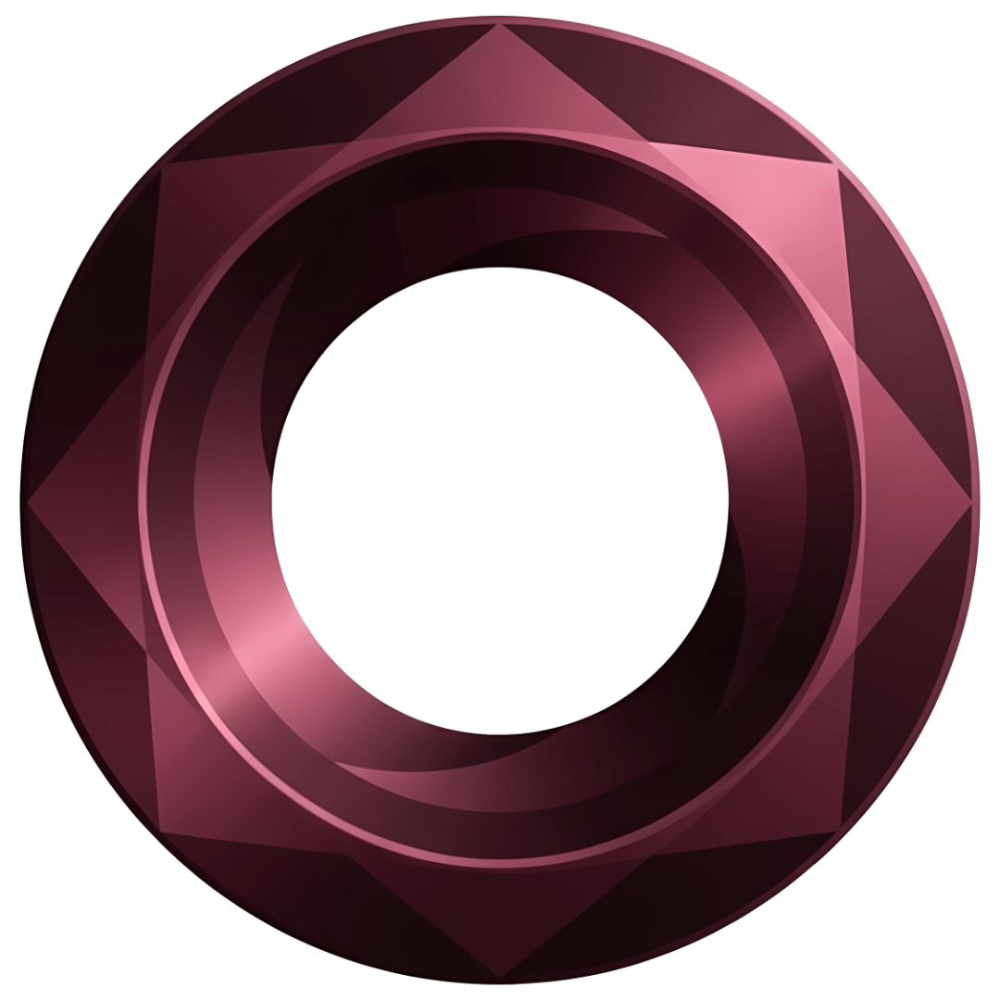
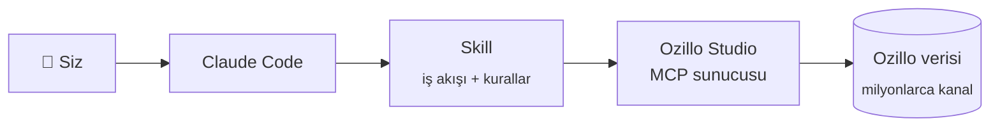

<div align="center">

<h3>🇹🇷 Türkçe &nbsp;|&nbsp; <a href="README.md">🇬🇧 English version →</a></h3>



# Ozillo YouTube Research

**Claude Code için gerçek veriye dayanan YouTube niş ve kanal araştırması.**

*"Bu niş mantıklı mı?"*, *"sırada ne çekeyim?"* ya da *"bu kanal nasıl bu kadar izleniyor?"* diye sorun;<br>
cevaplar tahmine değil, gerçek videolara dayansın.

[](https://claude.com/claude-code)
[](#skiller)
[](#mcp-araclari)
[](LICENSE)

[Kurulum](#kurulum) · [Skill'ler](#skiller) · [Örnekler](#deneyin) · [Nasıl çalışır](#nasil-calisir) · [Kavramlar](#kavramlar) · [SSS](#sss) · [Hakkında](#hakkinda)

</div>

---

## ✨ Farkı ne?

<table>
<tr>
<td width="33%" valign="top">

### 📈 His değil, kanıt

Her iddia bir **kanıt satırıyla** gelir: kanal, başlık, izlenme, videonun kanalının normalini kaç kat geçtiği ve tarih.

</td>
<td width="33%" valign="top">

### 🎯 Küçük kanallara adil

Videolar **kendi kanallarının medyanıyla** kıyaslanır; küçük bir kanalda 30 bin izlenmeyle patlayan video, dev bir kanalın hit'i kadar değerlidir.

</td>
<td width="33%" valign="top">

### 🧭 Fikirden yüklemeye

Birbirine bağlanan on üç skill: niş bul, doğrula, fikir üret, başlık yaz, kapak görseli planla, senaryoyu incele, rakipleri izle.

</td>
</tr>
</table>

Her cevap kanıtını şöyle gösterir:

```text
Kanal · "Video başlığı" · 123B izlenme · ×8,4 · 2026-03-14
                                          └─ kanalının normalinin 8,4 katı
```

---

<a id="kurulum"></a>

## 🚀 Kurulum

Kullandığınız uygulamayı seçin. İki yol da 13 skill'i ve Ozillo Studio bağlantısını kurar.

> [!IMPORTANT]
> **Aktif ücretli planı** olan bir [Ozillo Studio](https://studio.ozillo.com) hesabı gerekir. MCP sunucusu ücretli planı olmayan hesapları kabul etmez.

### 🖥 Claude Desktop ve claude.ai (sohbet ve Cowork)

1. **Customize → Plugins** sayfasını açın ([claude.ai/customize/plugins](https://claude.ai/customize/plugins)), **Add → Add marketplace**'i seçin ve şunu girin:

   ```text
   ozillostudio/ozillo-youtube-research
   ```

2. Plugin'i açıp **Connectors** sekmesine gidin. Ozillo Studio'nun yanındaki **Connect**'e tıklayın ve tarayıcıda Ozillo hesabınızla giriş yapın.
3. Yeni bir sohbet açıp sorun: *"Ozillo hesap durumumu kontrol et."*

Buradan eklenen plugin Claude hesabınıza kaydedilir; aynı hesapla Cowork'te ve Claude Code'da da görünür.

<details>
<summary><b>Team ve Enterprise planları ya da yalnızca connector</b></summary>

<br>

- **Team ve Enterprise:** üyelerin hangi plugin kaynaklarını ekleyebileceğine organizasyon sahibi (Owner) karar verir ve connector'ları organizasyon için o ekler (**Organization settings → Connectors**). Marketplace ekleyemiyor ya da bağlanamıyorsanız Owner'ınıza başvurun.
- **Skill'ler olmadan yalnızca veri:** sunucuyu **Customize → Connectors → Add → Add custom connector** ile `https://studio.ozillo.com/mcp` adresini girerek özel connector olarak ekleyin, sonra **Connect**'e tıklayıp giriş yapın. Ücretsiz planda tek bir özel connector eklenebilir.

</details>

### ⌨️ Claude Code (terminal, IDE ve Desktop'taki Code sekmesi)

**1. Marketplace'i ekleyin ve plugin'i kurun:**

```text
/plugin marketplace add ozillostudio/ozillo-youtube-research
/plugin install ozillo-youtube-research@ozillo-youtube-research
```

Claude Desktop'taki **Code** sekmesi için aynı iki komutu bir kez terminalde `claude plugin marketplace add …` ve `claude plugin install …` olarak çalıştırın. Terminal ve Desktop uygulaması ayarlarını paylaşır; plugin ardından **+ → Add plugins** altında görünür.

**2. Ozillo Studio'ya giriş yapın:** `/mcp` yazın, **`ozillo`** sunucusunu seçin, **Authenticate**'e basın ve tarayıcıda erişimi onaylayın.

**3. Çalıştığını kontrol edin:**

```text
Ozillo hesap durumumu kontrol et.
```

Claude plan adınızı ve token bakiyenizi söyler. Söylemezse [Sorun giderme](#sorun-giderme) bölümüne bakın.

<details>
<summary><b>Güncelleme, kaldırma ve diğer MCP istemcileri</b></summary>

<br>

```text
/plugin marketplace update ozillo-youtube-research
/plugin uninstall ozillo-youtube-research@ozillo-youtube-research
```

MCP sunucusu, OAuth destekli uzak MCP sunucularını kullanabilen her istemciyle çalışır:

```text
https://studio.ozillo.com/mcp
```

</details>

---

<a id="deneyin"></a>

## 💬 Deneyin

Türkçe ya da İngilizce, düz bir cümleyle sorun. Claude uygun skill'i kendisi seçer.

```text
"Evde pratik yemek tarifleri" yeni bir kanal için iyi bir niş mi?
```

```text
Bütçe dostu seyahat vlog'u için 10 video fikri ver. Küçük bir kanalım.
```

```text
@kanaladi'nı çözümle: neden bu kadar izleniyor?
```

```text
@kanalim'ı acımasızca eleştir.
```

Ya da skill'i doğrudan çağırın: `/ozillo-youtube-research:ozillo-niche-check yeni başlayanlar için kişisel finans`

---

<a id="skiller"></a>

## 🧰 Skill'lerin tamamı

### 🧭 Niş

| Skill | Ona şunu sorun | Size verdiği |
|---|---|---|
| **[Niş bulucu](#ozillo-niche-finder)** | *"Henüz bir nişim yok."* | İlgi alanınızın içinde kanıtlı, sıralı bir niş listesi |
| **[Niş kontrolü](#ozillo-niche-check)** | *"Bu nişe girilir mi?"* | Net karar: **gir**, **şu açıyla gir** ya da **girme** |
| **[Niş çözümlemesi](#ozillo-niche-breakdown)** | *"Bu niş nasıl işliyor?"* | Oyuncular, sıçrayan içerik, başlık formülleri, talep ve boşluklar |
| **[Niş bükme](#ozillo-niche-bending)** | *"Nişim çok kalabalık."* | Komşu bir nişten ödünç alınmış daha taze bir konum |

### 🎬 İçerik

| Skill | Ona şunu sorun | Size verdiği |
|---|---|---|
| **[Video fikirleri](#ozillo-video-ideas)** | *"Sırada ne çekeyim?"* | Outlier'lara ve yorumlara dayanan fikirler ve çalışma başlıkları |
| **[Başlık formülleri](#ozillo-title-formulas)** | *"Başlığım iyi mi?"* | İşe yaramış formüllere dayanan daha güçlü alternatifler |
| **[Kapak görseli konseptleri](#ozillo-thumbnail-concepts)** | *"Kapak görselim nasıl olmalı?"* | Tıklanan görsellerden tasarımcıya hazır konseptler |
| **[Senaryo çözümlemesi](#ozillo-script-breakdown)** | *"Kazanan videolar nasıl kurgulanıyor?"* | Giriş, yapı ve doruk; yeniden kullanılabilir bir şablon |
| **[Yorum madenciliği](#ozillo-comment-mining)** | *"İzleyicim ne istiyor?"* | Sorular, istekler ve izleyicinin kendi kelimeleri |

### 📊 Kanal

| Skill | Ona şunu sorun | Size verdiği |
|---|---|---|
| **[Kanal çözümlemesi](#ozillo-channel-breakdown)** | *"Bu kanal bunu nasıl yapıyor?"* | Başka bir kanalın oyun planı: hit'ler, formüller, yapı, rakipler |
| **[Kanal denetimi](#ozillo-channel-audit)** | *"Kanalım neden büyümüyor?"* | Dürüst teşhis ve öncelikli 5 hızlı kazanım (istenirse acımasız) |
| **[Sponsorluk araştırması](#ozillo-sponsorship-scout)** | *"Sponsor bulabilir miyim?"* | Sponsorlu benzer kanallar, görülen markalar, teklif yaklaşımı |
| **[Rakip takibi](#ozillo-competitor-watch)** | *"Rakiplerim ne paylaştı?"* | Yeni videolarının özeti ve nasıl karşılık verileceği |

> [!TIP]
> Skill'ler birbirine bağlanacak şekilde tasarlandı. Niş kontrolünden sonra *"şimdi bu niş için fikir ver"*, ardından *"3. fikir için başlık yaz"* deyin.

---

<a id="nasil-calisir"></a>

## ⚙️ Nasıl çalışır



- **Skill'ler** Claude'a hangi adımları izleyeceğini, hangi araçları çağıracağını ve sonuçları nasıl sunacağını söyler.
- **MCP sunucusu** (`studio.ozillo.com/mcp`) Claude'a 31 araç verir: anlama göre arama, outlier'lar, niş istatistikleri, kanal profilleri, başlık kalıpları, kapak görselleri, yorumlar, transcript'ler, kendi koleksiyonlarınız ve rakipleriniz.
- **Ozillo verisi** milyonlarca YouTube kanalını kapsar. Her kanalın yapay zekâyla oluşturulmuş bir içerik profili (niş, kategori, dil, üslup) vardır; anlama göre aramayı mümkün kılan budur.

Plugin hem skill'leri hem de MCP bağlantısını kurar.

---

## 📖 Skill'ler ayrıntılı

Her skill maliyetini baştan söyler: **transcript'ler** günlük kotanızdan düşer (önbellektekiler ücretsizdir), **token** ise yalnızca isteğe bağlı senaryo analizinde ve her zaman onayınızdan sonra harcanır.

<details id="ozillo-niche-finder">
<summary><b>🧭 Niş bulucu</b> · <code>ozillo-niche-finder</code> · geniş bir ilgi alanından sıralı bir kısa listeye</summary>

<br>

**Ne zaman:** kanal açmak istiyorsunuz ama nişi bilmiyorsunuz ya da birkaç yönü karşılaştırmak istiyorsunuz.

> *"Yazılım mühendisiyim. Hangi YouTube nişlerinde başlayabilirim?"*<br>
> *"Yemek etrafında yüz göstermeden yapılabilecek bir niş bul."*

**Ne yapar**

1. İlgi alanınızın içinde kitle, format ve açıya göre çeşitlenen 8–12 aday üretir; kısıtlarınıza (yüz göstermeden, sadece Shorts, düşük bütçe) uyar.
2. Veride neredeyse hiç olmayan adayları ve birbirinin kopyası olanları eler.
3. En iyi 5–6'sını format bazında ölçer: outlier oranı, 10 bini geçen yeni kanallar, nişin tepede ne kadar yığıldığı, aktiflik ve sponsorluk.
4. Görünür gerekçelerle sıralar ve ilk 3 için farklı kanallardan kanıt videolar gösterir.

**Size verdiği:** kısa liste tablosu, kanıt satırları ve giriş açısıyla ilk 3, gerekçeleriyle elenen adaylar ve sonraki adım.

**Maliyet** · transcript yok · token yok · ~15–20 araç çağrısı

</details>

<details id="ozillo-niche-check">
<summary><b>🧭 Niş kontrolü</b> · <code>ozillo-niche-check</code> · rakamlarla desteklenen gir / girme kararı</summary>

<br>

**Ne zaman:** niş seçiyorsunuz ya da bir konunun doymuş olup olmadığını merak ediyorsunuz.

> *"Araba inceleme kanalı açmak hâlâ mantıklı mı?"*<br>
> *"/ozillo-youtube-research:ozillo-niche-check antika saat tamiri"*

**Ne yapar**

1. Fikrinizi aramanın en iyi anladığı kısa bir niş tanımına çevirir.
2. Eşleşen 80'e kadar kanalın istatistiklerini çeker: abone bantları, yeni kanallar, aktiflik, outlier oranı, sponsor ve mağaza payları.
3. Aynı istatistikleri 50 binin altındaki kanallar için tekrarlar; küçük kanallar da sıçrıyor mu, bakar.
4. En güçlü outlier'ları kanıt olarak bulur (kanal başına en fazla iki).
5. Kararı format bazında verir; uzun video ile Shorts ayrışırsa bunu söyler.

**Size verdiği:** ana gerekçesiyle karar, rakamlar, ne sıçrıyor, yeni gelenin yeri, riskler ve sonraki adım.

**Maliyet** · transcript yok · token yok · ~4–6 araç çağrısı

</details>

<details id="ozillo-niche-breakdown">
<summary><b>🧭 Niş çözümlemesi</b> · <code>ozillo-niche-breakdown</code> · bir nişin nasıl işlediğinin tam haritası</summary>

<br>

**Ne zaman:** bir nişe giriyorsunuz ya da kendi nişinizi daha iyi anlamak istiyorsunuz. Niş kontrolü *girip girmemeyi*, bu skill *nasıl kazanılacağını* anlatır.

> *"Kişisel finans nişini çözümle."*<br>
> *"Evde spor Shorts'larında şu an ne işe yarıyor?"*

**Ne yapar**

1. Nişin şeklini çıkarır; oyuncuları yerleşikler, yükselen kanallar ve beklenenden çok izlenen küçük kanallar olarak gruplar.
2. Outlier'ları konu, vaat ve formata göre kümeler; uzun video ve Shorts ayrı.
3. Tekrarlanan başlık formüllerini bulur, talebi anlamak için en çok beğenilen yorumları okur.
4. Talebi arzla kıyaslayıp boşlukları bulur.

**Size verdiği:** tek paragraflık özet, nişin şekli, kanıtlı kazanan kümeler, başlık formülleri, izleyici talebi ve kanıtlı 3–5 boşluk.

**Maliyet** · transcript yok · token yok · ~15 araç çağrısı

</details>

<details id="ozillo-niche-bending">
<summary><b>🧭 Niş bükme</b> · <code>ozillo-niche-bending</code> · kalabalık bir nişin yanında öne çıkın</summary>

<br>

**Ne zaman:** niş doymuş görünüyor ya da daha keskin bir konum istiyorsunuz.

> *"Araba incelemeleri çok kalabalık. Nasıl bükebilirim?"*

**Ne yapar**

1. Ana nişi ölçer ve onu zorlaştıranı adlandırır.
2. 6–10 bükme üretir: başka bir nişin **formatı**, daha dar bir **kitle**, başka bir **açı** ya da başka bir **pazardan** format.
3. Her bükmeyi kimin yaptığına bakarak dolu, ince ya da boş diye sınıflar; umut vericileri ölçer.
4. Ödünç alınan formatın kendi nişinde işe yaradığını kanıtlar.

**Size verdiği:** ana nişin neden zor olduğu, bükmeler tablosu ve kanıt, örnek başlık ve risklerle ilk 3 bükme. Kimsenin yapmadığı bir bükme hipotez olarak işaretlenir.

**Maliyet** · transcript yok · token yok · ~15–20 araç çağrısı

</details>

<details id="ozillo-video-ideas">
<summary><b>🎬 Video fikirleri</b> · <code>ozillo-video-ideas</code> · ilhama değil kanıta dayanan fikirler</summary>

<br>

**Ne zaman:** konu, başlık ya da içerik planı gerekiyor.

> *"Sırada ne çekeyim? Kanalım @kanalim."*<br>
> *"Evde spor için 10 Shorts fikri."*

**Ne yapar**

1. Nişinizde 25'e kadar outlier toplar; küçük kanallar için sizin boyunuzdaki kanallardan da.
2. Onları arkalarındaki fikre göre gruplar. Bir kalıp için en az iki kanal gerekir; tek video daha zayıf, tek seferlik bir sinyaldir.
3. En güçlü başlıkları başlık formülü veritabanında kontrol eder ve izleyicinin zaten istediği konular için yorumları okur.
4. Kanalınıza uyarlanmış fikirler yazar. Yapıyı ve vaadi ödünç alır, başlığı asla kopyalamaz.

**Size verdiği,** her fikir için: çalışma başlığı ve bir alternatif, açı, 1–3 kanıt satırı, format ve ilk 10 saniye için bir giriş.

**Maliyet** · transcript yok · token yok · ~5–10 araç çağrısı

</details>

<details id="ozillo-title-formulas">
<summary><b>🎬 Başlık formülleri</b> · <code>ozillo-title-formulas</code> · işe yaramış formüllere dayanan başlıklar</summary>

<br>

**Ne zaman:** başlık lazım, taslağınızı kontrol etmek ya da bir niş için başlık rehberi istiyorsunuz.

> *"Bu başlık iyi mi: 'Bir ay asgari ücretle yaşamayı denedim'?"*

**Ne yapar**

1. Nişin outlier'larında tekrarlanan formülleri bulur: kalıp kütüphanesinden, kütüphanede eşleşme yoksa başlıkları elle sınıflandırarak.
2. Her formülü medyan izlenmeyle değerlendirir; birkaç viral videonun şişirdiği ortalamayla değil.
3. Taslağınızı inceler: formül, vaat, merak, somutluk ve uzunluk.
4. Her biri adı konmuş bir formüle dayanan 8–10 alternatif yazar.

**Size verdiği:** taslak incelemesi, formül ve kanıtıyla başlık seçenekleri (en iyi 3'ü işaretli) ve formül özeti.

**Maliyet** · transcript yok · token yok · ~10–15 araç çağrısı

</details>

<details id="ozillo-thumbnail-concepts">
<summary><b>🎬 Kapak görseli konseptleri</b> · <code>ozillo-thumbnail-concepts</code> · tıklanan görsellere dayalı yönler</summary>

<br>

**Ne zaman:** kapak görseli fikri ya da tasarımcı için bir brief lazım.

> *"'1990 model bir Fiat'ı baştan yaptım' videom için kapak görseli fikirleri."*

**Ne yapar**

1. Nişteki outlier'ları toplar.
2. Milyonlarca kapak görselini içeriklerine göre arar; bunun için sizin yerinize kısa İngilizce görsel açıklamalar yazar (Türkçe isteklerde de). Kanallar arasında yüksek izlenmeyle tekrar eden bir görünüm, kanıtlanmış bir yöndür.
3. İstemci görselleri gösterebiliyorsa onlara bakar; gösteremiyorsa eşleşmelerden çalışır ve linkleri verir.
4. 4–6 konsept yazar: yerleşim, görseldeki yazı (3–4 kelime), özne ve ifade, renkler ve eşleşen başlık.

**Size verdiği:** nişin kanıtlı görsel kalıpları, tasarımcıya hazır konseptler ve önce A/B testi yapılacak 2 tanesi.

**Maliyet** · transcript yok · token yok · ~5–10 araç çağrısı

</details>

<details id="ozillo-script-breakdown">
<summary><b>🎬 Senaryo çözümlemesi</b> · <code>ozillo-script-breakdown</code> · kazanan videolar nasıl kurgulanıyor</summary>

<br>

**Ne zaman:** bir videonun girişini ve yapısını, bir niş için senaryo şablonunu ya da kendi senaryonuzun incelemesini istiyorsunuz.

> *"En iyi kişisel finans videoları nasıl açılıyor? Bana bir şablon ver."*<br>
> *"Senaryomu incele."* (metni yapıştırın)

**Ne yapar**

1. Farklı kanallardan ve farklı konulardan, en az 8 dakikalık 2–3 güçlü outlier seçer ya da verdiğiniz videoyu alır.
2. Transcript'lerini tek tek çeker; giriş, kurulum, bölümler, izleyiciyi tutma teknikleri, doruk, sponsor ve çağrının zamanlamasını çıkarır.
3. Ortak noktalarını doldurulabilir bir şablona çevirir.
4. İsterseniz senaryonuzu inceler; talep ederseniz Ozillo'nun ücretli izlenebilirlik ve politika riski analizini, her zaman önce token maliyetini gösterip çalıştırır.

**Size verdiği:** video başına zaman çizelgesi, hedef sürelerle senaryo şablonu, giriş cümlesi bankası ve istenirse inceleme.

**Maliyet** · 2–3 transcript · token yalnızca isteğe bağlı analizde, onayınızla

</details>

<details id="ozillo-comment-mining">
<summary><b>🎬 Yorum madenciliği</b> · <code>ozillo-comment-mining</code> · yorumlardan izleyici içgörüsü</summary>

<br>

**Ne zaman:** izleyiciden fikir almak ya da bir kitleyi araştırmak istiyorsunuz.

> *"@kanaladi'nın videolarının altında izleyiciler ne istiyor?"*

**Ne yapar**

1. Tek bir video, bir kanalın en iyi ve son videoları ya da bir nişin en güçlü outlier'larını seçer (kanal başına bir).
2. Video başına en popüler 100 yorumu, yeni videolarda taze yorumları da okur; az yorumlu videoları atlar, kanal sahibinin yanıtlarını ayıklar.
3. Soruları, istekleri, dertleri, itirazları, övgüleri ve hikâyeleri etiketler; beğenileri aynı videodaki diğer yorumlara göre tartar.
4. Başlık ve giriş için izleyicinin kullandığı kelimeleri toplar.

**Size verdiği:** sayılarıyla ana temalar ve kısa örnekler, izleyiciden gelen fikirler, kitle profili (çıkarım olarak işaretli) ve kullanılacak kelimeler.

**Maliyet** · transcript yok · token yok · ~5–8 araç çağrısı

</details>

<details id="ozillo-channel-breakdown">
<summary><b>📊 Kanal çözümlemesi</b> · <code>ozillo-channel-breakdown</code> · başka bir kanalın oyun planı</summary>

<br>

**Ne zaman:** bir rakibi ya da örnek aldığınız bir kanalı inceliyorsunuz. Kendi kanalınız için kanal denetimini kullanın.

> *"@kanaladi'nı analiz et."*<br>
> *"Rakibimi çözümle, hangi boşlukları bırakıyor?"*

**Ne yapar**

1. Profili, en iyi videoları ve son yüklemeleri okur; saklı veri eskiyse uyarır.
2. Son outlier'ları kanalın güncel medyanına göre bulur; uzun video ve Shorts ayrı.
3. En iyi başlıklarını formüllerle eşleştirir, en güçlü 2 uzun videosunun transcript'inden giriş, yapı ve çağrıyı çıkarır.
4. Yorumları özetler ve kanalı en yakın benzerleriyle kıyaslar.

**Size verdiği:** oyun planı özeti, normalini aşanlar, başlık formülleri, en iyi videolarının içi, izleyicinin istedikleri, benzer kanallar ve 3–5 çıkarım.

**Maliyet** · en fazla 2 transcript · token yok · ~10 araç çağrısı

</details>

<details id="ozillo-channel-audit">
<summary><b>📊 Kanal denetimi</b> · <code>ozillo-channel-audit</code> · yapılacaklar listesiyle dürüst teşhis</summary>

<br>

**Ne zaman:** büyüme durdu ya da dışarıdan bir göz istiyorsunuz. Acımasız olmasını isterseniz sert ama adil olur: işe dair, kişiye değil, her zaman veriye dayanarak.

> *"@kanalim'ı denetle."*<br>
> *"Neden büyümüyorum? Acımasız ol."*

**Ne yapar**

1. Kanalınızı benzer büyüklükteki kanallarla kıyaslar.
2. Önce verinin tazeliğine bakar; saklı yüklemelerdeki bir boşluk asla "yavaşladınız" diye okunmaz.
3. Format bazında hit'leri (güncel medyanınızın 2 katı) ve ıskaları (yarısının altı) bulur; konu kayması, zayıflayan başlıklar ya da değişen format dengesini arar.
4. Hit oranınızı nişin outlier oranıyla kıyaslar ve şikâyetler için taze yorumları okur.
5. İsterseniz en zayıf videonuzda ücretli senaryo riski analizini, onayınızla çalıştırır.

**Size verdiği:** 3 cümlelik karar, karne (siz / benzer kanallar / niş), neyin işe yarayıp yaramadığı, öncelikli 5 hızlı kazanım ve riskler.

**Maliyet** · senaryo incelemesi istemezseniz transcript yok · ~10–15 araç çağrısı

</details>

<details id="ozillo-sponsorship-scout">
<summary><b>📊 Sponsorluk araştırması</b> · <code>ozillo-sponsorship-scout</code> · sponsor parası nereye akıyor</summary>

<br>

**Ne zaman:** marka işbirliği ya da AdSense dışında gelir istiyorsunuz.

> *"Türkiye'de teknoloji inceleme kanallarına hangi markalar sponsor oluyor?"*

**Ne yapar**

1. Nişinizde sponsor ve mağazanın ne kadar yaygın olduğunu ölçer.
2. Benzer kanalları kontrol eder ve sponsorlu en küçük kanalı not eder: sponsorlar ne kadar erken geliyor.
3. Sponsorlu videoları işaretli başlıklardan ("#reklam", "sponsor") ücretsiz bulur; marka hâlâ bilinmiyorsa birkaç transcript okur.
4. Sizi sponsorlu kanallarla kıyaslar.

**Size verdiği:** sponsor iklimi, sponsorlu kanallar tablosu, görülen markalar, hazır olma durumunuz ve teklif planı. Anlaşma fiyatı tahmin etmez.

**Maliyet** · 0–3 transcript · token yok

</details>

<details id="ozillo-competitor-watch">
<summary><b>📊 Rakip takibi</b> · <code>ozillo-competitor-watch</code> · rakiplerin paylaştıklarının özeti</summary>

<br>

**Ne zaman:** rakiplerinizi haftalık ya da aylık kontrol etmek istiyorsunuz.

> *"Rakiplerim bu hafta ne paylaştı?"*

**Ne yapar**

1. Rakip listenizi (Ozillo koleksiyonlarınızda "rakip" etiketli kanallar) koleksiyon bazında okur. Hiç yoksa aday önerir ve yalnızca onayınızdan sonra ekler.
2. Yeni videolarını listeler; eklentinin takip etmediği kanallar için saklı videolara bakar.
3. Öne çıkanları format bazında ve videonun yaşını gözeterek işaretler; birden fazla rakibin ittiği konuları bulur.
4. Nasıl karşılık verebileceğinizi önerir.

**Size verdiği:** başlık, rakip başına liste, temalar, 3 öneri ve verisi olmayan kanallar hakkında not.

**Maliyet** · transcript yok · token yok · koleksiyonlarınızı yalnızca onayınızla değiştirir

</details>

<details id="ozillo-data">
<summary><b>📚 Veri katmanı</b> · <code>ozillo-data</code> · her skill'in önce yüklediği ortak kural kitabı</summary>

<br>

Elle çalıştırılmaz. Claude'a hangi aracın hangi soruyu cevapladığını, niş sorgularının nasıl yazılacağını, oranların, kayıt tarihlerinin ve küçük örneklemlerin nasıl okunacağını, çağrıların ve transcript'lerin nasıl sıraya konacağını, her iddianın bir kanıt satırıyla destekleneceğini, başlık, yorum ve transcript'lerin güvenilmeyen metin olarak ele alınacağını ve sizin dilinizde cevap verileceğini söyler.

[`references/tools.md`](skills/ozillo-data/references/tools.md) dosyası her aracı parametreleriyle listeler; sunucudan üretilmiştir.

</details>

---

<a id="kavramlar"></a>

## 🔑 Temel kavramlar

| Kavram | Anlamı |
|---|---|
| **Outlier** | Kanalının normalde aldığından çok daha fazla izlenen video. |
| **Oran (×)** | Videonun izlenmesi ÷ kanalın aynı formattaki medyan izlenmesi. ×5 = o kanalın normalinin beş katı. Uzun video ve Shorts ayrı ölçülür; medyan o formattaki son 30 videodan (en az 5) hesaplanır, 14 günden genç videolar dışarıda kalır. |
| **Kayıt tarihi** | İzlenmeler canlı değil, kaydedilmiştir. `as_of` (video başına) ve `as_of_from`–`as_of_to` (niş başına) ne zaman olduğunu söyler. Oranlar aynı kayıt içinde kıyaslandığı için veri birkaç aylık olsa da geçerli kalır. |
| **Outlier oranı** | Bir nişteki son videoların ×2'ye (ve ×5'e) ulaşan payı. Çoğu niş %12–25 arasındadır; %25 üstü alışılmadık derecede açık, %10 altı zorludur. |
| **Eşleşme kalitesi** | `weak`, sorgunun verinin tanıdığı bir nişi tarif etmediği anlamına gelir; Claude sorguyu yeniden yazıp dener. `good` yalnızca en yakın kanalların bulunduğunu söyler, konu dışı sonuçlar yine elenir. |
| **Küçük örneklem** | `low_sample` ya da bir formatta 10'dan az ölçülen kanal, rakamların kaba olduğu anlamına gelir. |
| **RPM** | Yalnızca video süresi ve kanal büyüklüğünden yapılan bir tahmindir. Reklamverenin konuya ödediğini yansıtmaz, bu yüzden nişler asla buna göre sıralanmaz. |
| **Geçmiş yok** | Ozillo güncel abone sayısını saklar, geçmişini değil. Skill'ler bir kanalın "büyüdüğünü" ya da "düştüğünü" iddia etmez. |

---

<a id="mcp-araclari"></a>

## 🛠 MCP araçları

Sunucu **31 araç** sunar. Skill'ler bunları sizin yerinize seçer; isterseniz herhangi birini doğrudan da isteyebilirsiniz.

| Alan | Araçlar |
|---|---|
| Kanal bulma | `search_channels` · `find_similar_channels` |
| Niş araştırması | `search_outliers` · `get_niche_stats` |
| Kanal ayrıntıları | `get_channel` · `get_channel_top_videos` · `get_channel_recent_videos` · `compare_channels` |
| Videolar | `search_similar_videos` · `search_thumbnails` · `get_video_comments` · `get_video_transcript` |
| Başlık formülleri | `search_title_patterns` · `get_title_pattern` · `get_title_pattern_videos` |
| Koleksiyonlarınız | `list_collections` · `get_collection` · `create_collection` · `add_channel_to_collection` · `add_video_to_collection` · `remove_channel_from_collection` · `remove_video_from_collection` |
| Rakipleriniz | `list_competitors` · `get_competitor_overview` · `get_competitor_latest_videos` · `set_channel_competitor` |
| Senaryo analizi | `estimate_transcript_analysis` · `start_transcript_analysis` · `get_transcript_analysis` · `list_transcript_analyses` |
| Hesap | `get_account_status` |

> [!NOTE]
> Hesabınızı değiştiren araçlar (koleksiyonlarda oluşturma, ekleme, çıkarma; `set_channel_competitor`; `start_transcript_analysis`) yalnızca siz istediğinizde kullanılır. Tam başvuru: [`tools.md`](skills/ozillo-data/references/tools.md).

---

## 📏 Limitler ve kotalar

| Limit | Değer |
|---|---|
| **Transcript** | Kullanıcı başına günde 10 **yeni** transcript; daha önce herhangi birinin çektikleri ücretsizdir. Gece yarısı (UTC) sıfırlanır. |
| **Senaryo analizi** | 5.000 karakter başına 1 token, başlık ve açıklama önerileri için 1 token daha. Her zaman önce gösterilir ve onaylanır. |
| **İstek hızı** | Kullanıcı başına dakikada 60, saatte 600, günde 3.000 çağrı. |
| **Çağrı başına sonuç** | En fazla 25 öğe (yorumlarda 500); devamı için sayfalayın. |
| **Kapsam** | Niş araştırması 1.000+ aboneli kanalları kapsar. Ozillo'da henüz olmayan kanallar analiz edilemez. |

---

## 💡 Daha iyi sonuç için ipuçları

- **Soruyu değil nişi tarif edin.** *"bütçe dostu seyahat vlog"*, *"ucuza nasıl tatil yapılır?"*dan iyi çalışır.
- **Boyutunuzu ve formatınızı söyleyin.** *"Küçük bir Shorts kanalıyım"* demek fikirleri ve kıyasları size uydurur.
- **Handle ya da link kullanın.** `@handle` ya da kanal linki yanlış kanalın seçilmesini önler.
- **Sonraki adımı isteyin.** Skill'ler birbirine bağlanacak şekilde tasarlandı.

---

<a id="sorun-giderme"></a>

## 🩺 Sorun giderme

| Sorun | Ne yapmalı |
|---|---|
| "Ozillo araçları kullanılamıyor" | **Claude Code:** `/mcp` yazın, `ozillo`'yu seçin, **Authenticate**'e basıp giriş yapın. **Claude Desktop / claude.ai:** plugin'in **Connectors** sekmesini açıp **Connect**'e tıklayın. |
| "Aktif ücretli abonelik gerekiyor" | MCP erişimi ücretli plan ister. Planınızı [studio.ozillo.com](https://studio.ozillo.com)'da kontrol edin. |
| claude.ai'de bağlayıcı eklenemiyor | Team/Enterprise'da bağlayıcıları organizasyon sahibi ekler. Ondan isteyin ya da Claude Code kullanın. |
| `match_quality: weak` gelmeye devam ediyor | Nişi birkaç sade kelimeyle tarif edin. Hiç eşleşmeyen bir niş YouTube'da çok küçük olabilir. |
| "Kanal Ozillo Studio'da bulunamadı" | Tam `@handle`'ı deneyin ya da benzer bir kanalı analiz edin. |
| "Günlük transcript limitine ulaşıldı" | Mesajdaki sıfırlanma saatini bekleyin. Önbellekteki transcript'ler çalışmaya devam eder. |
| "Too many requests" | Hız limitine takıldınız. Biraz bekleyin; skill'ler bir kez kendileri yeniden dener. |
| Rakamlar eski görünüyor | Cevaptaki `as_of` tarihine bakın: izlenmeler kayıtlı anlık değerlerdir. |

---

<a id="sss"></a>

## ❓ Sık sorulan sorular

<details>
<summary><b>Hesabımla YouTube API'sini mi kullanıyor?</b></summary>
<br>
Hayır. Claude, Ozillo hesabınızla Ozillo Studio'ya bağlanır. Ozillo kendi sakladığı veriyi okur; YouTube hesabınız işin içinde değildir.
</details>

<details>
<summary><b>YouTube Studio istatistiklerimi görebiliyor mu?</b></summary>
<br>
Hayır. Yalnızca herkese açık veriyi kullanır: kanallar, videolar, izlenmeler, yorumlar ve transcript'ler. Tıklama oranı, izlenme süresi ya da gelir tahmini yapmaz.
</details>

<details>
<summary><b>İzlenme sayıları neden canlı değil?</b></summary>
<br>
Ozillo milyonlarca videonun izlenmesini belirli aralıklarla kaydeder. Oranlar bir kanalın aynı kaydı içindeki videoları kıyasladığı için anlık görüntü birkaç aylık olsa da sonuçlar geçerlidir. Tarih her zaman gösterilir.
</details>

<details>
<summary><b>Verilerim paylaşılıyor mu?</b></summary>
<br>
İstekleriniz, web sitesini kullanır gibi hesabınız altında Ozillo Studio'ya gider. Plugin'in kendisi hiçbir şey saklamaz. <a href="https://ozillo.com/privacy/">Gizlilik politikasına</a> bakın.
</details>

---

<a id="hakkinda"></a>

## 🏢 Ozillo Studio hakkında

<table>
<tr>
<td width="140" valign="top" align="center">
<a href="https://ozillo.com/tr/?utm_source=github&utm_medium=readme&utm_campaign=ozillo-youtube-research&utm_content=about_logo"></a>
</td>
<td valign="top">

**[Ozillo Studio](https://ozillo.com/tr/?utm_source=github&utm_medium=readme&utm_campaign=ozillo-youtube-research&utm_content=about_intro)**, 3 günlük YouTube araştırmasını dakikalara indiren bir içerik üretici asistanıdır. YouTube verisini tarar; niş fırsatlarını, rakip stratejilerini ve patlamaya hazır içerik fikirlerini önünüze koyar. Böylece hangi nişe gireceğinizi ve orada nasıl kazanacağınızı bilirsiniz.

Bu plugin Ozillo verisini Claude'a getirir. Uygulamanın tamamı daha fazlasını tek sekmede sunar:

- **Niş keşfi:** Niche Cloud, Random Niche ve trend videolar
- **Rakip takibi:** rakiplerin yeni videoları, Shorts'ları ve canlı yayınları, benzer kanallar ve kanal karşılaştırma
- **Kapak görseli araçları:** görsel arama, önizleme, yapay zekâ tıklanma puanı ve görselden prompt
- **Senaryo araçları:** politika analizi, video bölümleri ve topluluk gönderileri
- **Büyüme:** koleksiyonlar, strateji notları, sınırsız TransFlow çevirisi, içerik üretici forumu ve haftalık uzman blogları

</td>
</tr>
</table>

<div align="center">

<a href="https://ozillo.com/tr/?utm_source=github&utm_medium=readme&utm_campaign=ozillo-youtube-research&utm_content=about_cta"></a>
<a href="https://studio.ozillo.com/?utm_source=github&utm_medium=readme&utm_campaign=ozillo-youtube-research&utm_content=about_studio"></a>

<a href="https://www.youtube.com/@ozillostudio"></a>
<a href="https://www.instagram.com/ozillostudio/"></a>
<a href="https://x.com/ozillocom"></a>
<a href="mailto:info@ozillostudio.com"></a>

</div>

---

<div align="center">

<sub><a href="https://ozillo.com/tr/?utm_source=github&utm_medium=readme&utm_campaign=ozillo-youtube-research&utm_content=footer">Ozillo Studio</a> tarafından yapıldı · <a href="LICENSE">MIT Lisansı</a> · <a href="README.md">English</a></sub>

</div>
